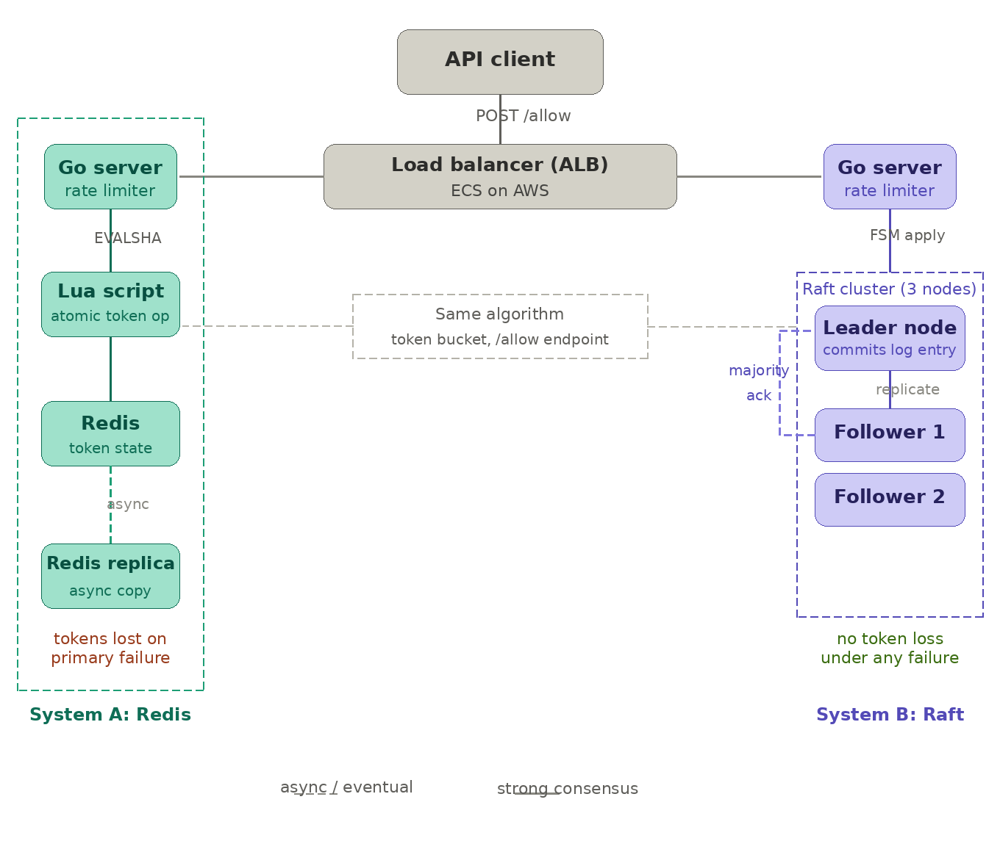

# Redis vs Raft: Distributed Rate Limiting

**What happens to your rate limiter when a server crashes?**
We built the same rate limiter two ways, deployed both on AWS, and broke them on purpose to find out.


## The idea in 30 seconds

A **rate limiter** is a bouncer for your API: each user gets a fixed budget of requests, and anything over the limit is turned away (`429 Too Many Requests`). That's easy on one server. It's hard when your API runs on many servers that all need to agree on how much budget each user has left.

| | 🟢 Redis | 🟣 Raft |
|---|---|---|
| **How it works** | One shared store that every server reads and writes | 3 nodes keep identical copies and vote on every update |
| **Strength** | Fast and simple | Keeps working when a node crashes |
| **Weakness** | Single point of failure | Slower, since every write needs a majority vote |

Both use the same algorithm (token bucket), the same API and the same load, so any difference comes from the architecture alone.



## What we found

| Failure we caused | Requests still served | What happened |
|---|---|---|
| 🟢 Redis crashes | **52.8%** | No failover, down until AWS restarts it (~61 s) |
| 🟣 Raft follower killed | **92.7%** | Leader kept serving, no election needed |
| 🟣 Raft leader killed | **97.3%** | New leader elected in 4.2 s |
| 🟣 Raft network partition | **91.6%** | New leader elected in 1.9 s |

Under normal load, the Raft cluster (with a cache in front) handled **2,443 requests/second at 1,000 concurrent users with 0 failures**.

**Bottom line:** Redis is simpler, but one crash drops about half the traffic. Raft adds some latency, but kept serving through every failure we threw at it.

---

## Deep Dive

Benchmarks two approaches to distributed rate limiting under identical load - a Redis-backed token bucket and a Raft consensus token bucket. The goal is to measure throughput, latency, and fault tolerance trade-offs between a single-master shared store and a replicated state machine.

---

## The Question

When you need rate limiting across many API nodes, two architectures are common:

- **Redis** - all nodes atomically read/write a shared Redis instance. Simple, fast, single point of failure.
- **Raft** - rate limit state is replicated across a consensus cluster. More complex, higher latency, no single point of failure.

This project runs both under the same load and measures what you actually give up and gain.

---

## Architecture

```
docker-compose.yml
├── src/redis-limiter/   Go HTTP API, token bucket via atomic Lua script on Redis
├── src/raft-limiter/    Go HTTP API, token bucket replicated via hashicorp/raft (3 nodes)
├── src/raft-api/        Caching + leader-forwarding layer in front of Raft cluster
├── experiments/         Locust harness + fault injection scripts
├── experimentsF/        Failure experiment drivers (Python)
├── infra/               Terraform for AWS (ECS, EC2, ALB, ElastiCache, ECR, VPC)
├── results/             Locust HTML reports (load tests)
├── resultsF/            Locust HTML reports (fault injection experiments)
├── decisions/           Architecture decision records (ADRs)
└── scripts/             Manual sanity check and burst test scripts
```

### Services

| Service | Description | Local port |
|---|---|---|
| `redis-limiter` | Go API backed by Redis (ElastiCache in AWS) | 8000 |
| `raft-node1` | Raft node 1 (bootstrap leader) | 8001 |
| `raft-node2` | Raft node 2 | 8002 |
| `raft-node3` | Raft node 3 | 8003 |
| `raft-api` | Caching proxy in front of Raft cluster | 8010 |
| `locust` | Load generator UI | 8089 |

### raft-api: why it exists

Sending every rate-limit check through Raft consensus is expensive - each request requires a majority commit across 3 nodes before responding. `raft-api` is a thin caching layer that sits in front of the cluster: cache hits return immediately, cache misses forward to the current Raft leader. This is the production-realistic deployment pattern.

### Unified API contract

Both limiters expose the same endpoints so the Locust harness works against either with no changes:

| Method | Path | Description |
|---|---|---|
| `GET` | `/check?user=<id>` | 200 = allowed, 429 = rate limited |
| `GET` | `/health` | Always 200 (ALB health check) |
| `GET` | `/status` | Backend info, cluster state |

### Token bucket algorithm

Both limiters use continuous refill:

```
tokens = min(capacity, tokens + elapsed_seconds * fill_rate)
```

Redis executes this atomically in a Lua script. Raft executes it inside `FSM.Apply()` after majority commit. Same algorithm, same config - any latency difference is attributable to the consensus mechanism alone.

### Raft cluster topology

3-node cluster. Node1 bootstraps as leader; node2 and node3 join via node1's HTTP `/join` endpoint. All writes must go to the leader - if a follower receives `/check`, it returns a 307 redirect to the current leader's address. Raft transport runs on port 7000; HTTP on port 8000 per node.

---

## Running Locally

### Start full stack

```bash
docker compose up --build
```

- Redis limiter: `http://localhost:8000`
- Raft node1/2/3: `http://localhost:8001`, `8002`, `8003`
- Raft API (cached): `http://localhost:8010`
- Locust UI: `http://localhost:8089` (targets redis-limiter by default)

### Switch Locust to target Raft

```bash
HOST=http://raft-api:8000 docker compose up locust
```

### Run headless benchmark

```bash
docker compose run --rm locust \
  -f /mnt/locust/locustfile.py \
  --host http://redis-limiter:8000 \
  --headless -u 200 -r 20 --run-time 120s \
  --html /mnt/locust/results/run.html
```

### Build and test individual services

```bash
cd src/redis-limiter && go build ./... && go test ./...
cd src/raft-limiter  && go build ./... && go test ./...
```

---

## AWS Deployment

Infrastructure is in `infra/` (Terraform). The architecture uses:

- **ALB** - single entry point, path-based routing (`/` to Redis, `/raft/` to Raft)
- **ECS Fargate** - Redis limiter and raft-api run as ECS services
- **EC2** - Raft nodes run on EC2 with fixed private IPs (required for stable Raft peer addressing - ECS task IPs are ephemeral)
- **ElastiCache** - managed Redis backing the redis-limiter
- **ECR** - container image registry

### One-time bootstrap

```bash
aws s3 mb s3://redisvraft-tfstate --region us-east-1
aws dynamodb create-table --table-name terraform-locks \
  --attribute-definitions AttributeName=LockID,AttributeType=S \
  --key-schema AttributeName=LockID,KeyType=HASH \
  --billing-mode PAY_PER_REQUEST --region us-east-1

cd infra && terraform init && terraform apply
```

### Build and push images

```bash
aws ecr get-login-password | docker login --username AWS --password-stdin <account>.dkr.ecr.us-east-1.amazonaws.com
docker build -t $(terraform output -raw ecr_redis_limiter):latest ../src/redis-limiter && docker push ...
docker build -t $(terraform output -raw ecr_raft_limiter):latest  ../src/raft-limiter  && docker push ...
```

---

## Experiments

### Load tests (AWS, ECS/EC2)

| Script | Description |
|---|---|
| `experiments/20_locust_steady_raft_cached.py` | Steady load against raft-api (cached) |
| `experiments/21_locust_ramp_raft_cached.py` | Ramping load, 0-1000 users |

### Fault injection

| Script | Experiment |
|---|---|
| `experimentsF/03_redis_failure.py` | Kill Redis ECS task, observe recovery |
| `experimentsF/04_follower_kill.py` | Kill a Raft follower node |
| `experimentsF/05_leader_kill_instance.py` | Terminate the Raft leader EC2 instance |
| `experimentsF/07_network_partition.py` | Partition leader from cluster via iptables |

---

## Results

### Load test (1000 users, Raft cached, ramping)

| Metric | Value |
|---|---|
| Throughput | 2,443 req/s |
| Median latency | 240 ms |
| p95 latency | 450 ms |
| p99 latency | 600 ms |
| Failures | 0 |

### Fault injection summary

| Experiment | Success rate during fault | Recovery time |
|---|---|---|
| Redis failure (no replication) | 52.78% | ~61.5s (ECS restart) |
| Raft follower kill | 92.70% | 78.3s |
| Raft leader kill (instance terminate) | 97.25% | 77.6s (election: 4.19s) |
| Raft network partition | 91.56% | 87.8s (election: 1.93s) |

**Key takeaway:** Redis failure drops over half of traffic with no automatic failover. Raft survives leader loss with a ~4 second election and stays above 91% success throughout every fault scenario.

---

## Configuration

### Redis limiter

| Variable | Default | Meaning |
|---|---|---|
| `REDIS_ADDR` | `localhost:6379` | Redis address |
| `CAPACITY` | `100` | Max tokens per bucket |
| `FILL_RATE` | `1` | Tokens added per second |
| `HTTP_ADDR` | `0.0.0.0:8000` | Listen address |

### Raft limiter

| Variable | Default | Meaning |
|---|---|---|
| `NODE_ID` | required | Unique node name |
| `RAFT_ADDR` | `localhost:7000` | Raft peer address |
| `HTTP_ADDR` | `localhost:8000` | HTTP listen address |
| `BOOTSTRAP` | `false` | Set `true` on node1 only |
| `JOIN_ADDR` | - | Leader HTTP address for non-bootstrap nodes |
| `MAX_TOKENS` | `100` | Bucket capacity |
| `WINDOW_SECS` | `60` | Converted to fill_rate = MAX_TOKENS / WINDOW_SECS |
| `HEARTBEAT_MS` | `1000` | Raft heartbeat timeout |
| `ELECTION_MS` | `1000` | Raft election timeout |

### raft-api

| Variable | Default | Meaning |
|---|---|---|
| `RAFT_NODES` | `raft-node1:8000,...` | Comma-separated Raft node addresses |
| `CACHE_TTL_SECS` | `1` | Per-user decision cache TTL |
| `HTTP_ADDR` | `0.0.0.0:8000` | Listen address |

---

## Design Decisions

All significant decisions are recorded as ADRs in `decisions/`:

- `001` - Unified API contract across both limiters
- `002` - Continuous token bucket algorithm (not fixed-window) for both
- `003` - EC2 with fixed private IPs for Raft (Cloud Map blocked in AWS Academy)
- `004` - Local Locust driver for fault experiments
- `005` - Terraform for AWS infrastructure

---

## Reports

Full benchmark and analysis reports are in `Report/`:

- `RedisVsRaft_Report.pdf` - Complete milestone report
